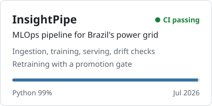
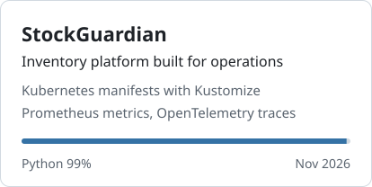
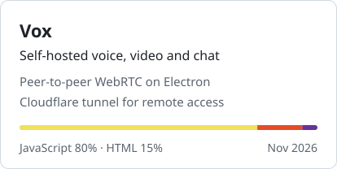
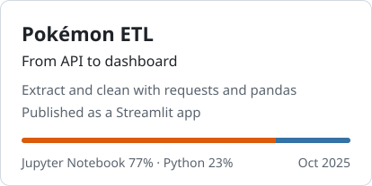

<picture>
  <source media="(max-width: 600px) and (prefers-color-scheme: dark)" srcset="https://raw.githubusercontent.com/viniciusog1/viniciusog1/main/assets/hero-small-dark.svg">
  <source media="(max-width: 600px)" srcset="https://raw.githubusercontent.com/viniciusog1/viniciusog1/main/assets/hero-small-light.svg">
  <source media="(prefers-color-scheme: dark)" srcset="https://raw.githubusercontent.com/viniciusog1/viniciusog1/main/assets/hero-dark.svg">
  
</picture>

 

I work with Python, SQL and data, and I'm moving into **DevOps**. I started in IT support, setting up Linux and Windows machines, networks and backups. Today my projects cover the path from commit to dashboard: tested in CI, packaged in Docker and monitored with Prometheus and Grafana.

[LinkedIn](https://www.linkedin.com/in/viniciusog1/) &nbsp;·&nbsp; [Email](mailto:viniciusog1010@gmail.com) &nbsp;·&nbsp; Brasília, Brazil

## Projects

<a href="https://github.com/viniciusog1/insightpipe"><picture><source media="(prefers-color-scheme: dark)" srcset="https://raw.githubusercontent.com/viniciusog1/viniciusog1/main/assets/insightpipe-dark.svg"></picture></a>
<a href="https://github.com/viniciusog1/stockguardian"><picture><source media="(prefers-color-scheme: dark)" srcset="https://raw.githubusercontent.com/viniciusog1/viniciusog1/main/assets/stockguardian-dark.svg"></picture></a>
<a href="https://github.com/viniciusog1/vox"><picture><source media="(prefers-color-scheme: dark)" srcset="https://raw.githubusercontent.com/viniciusog1/viniciusog1/main/assets/vox-dark.svg"></picture></a>
<a href="https://github.com/viniciusog1/pokemon_api"><picture><source media="(prefers-color-scheme: dark)" srcset="https://raw.githubusercontent.com/viniciusog1/viniciusog1/main/assets/pokemon_api-dark.svg"></picture></a>

## Toolbox

| Area | Tools |
| --- | --- |
| **CI and containers** | GitHub Actions, Docker, Docker Compose, Kubernetes manifests with Kustomize |
| **Observability** | Prometheus, Grafana, OpenTelemetry, Jaeger |
| **Backend** | Python, FastAPI, SQLAlchemy, Alembic, Redis, ARQ |
| **Data and ML** | SQL, PostgreSQL, pandas, scikit-learn, Power BI |
| **Quality** | pytest, ruff, mypy strict |
| **Learning next** | AWS, Terraform, continuous delivery |

This profile has its own pipeline: [GitHub Actions](https://github.com/viniciusog1/viniciusog1/actions/workflows/profile.yml) tests and rebuilds it every day. [See the code](scripts/build.py).
